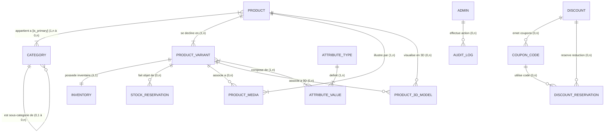

# ARTFIT — SPRINT 01 : MODÈLE CONCEPTUEL DE DONNÉES (MCD)
## Module : Gestion des Produits (CRUD)

- **Version du document :** 1.0.0
- **Statut :** Spécification Conceptuelle Validée
- **Date de conception :** 2026-11-16
- **Architecture obligatoire :** Architecture 3-Tiers (Couche Accès aux Données - DAL)
- **Langue du document :** Français simple — Niveau A1
- **Périmètre :** Marque unique ARTFIT — Sprint 01 : Gestion des Produits

---

## 1. But du Document

Ce document présente le **Modèle Conceptuel de Données (MCD)** du module Gestion des Produits pour ARTFIT.

Le MCD décrit :
- Les **entités** métier (les objets du système).
- Les **attributs** de chaque entité.
- Les **relations** et les **cardinalités** entre les entités.

Toutes les règles respectent les décisions confirmées :
1. **Marque unique :** `brand_name = 'ARTFIT'`.
2. **Devise unique :** Uniquement `MAD` (Dirham marocain).
3. **Hiérarchie de catégories sans limite :** Arborescence libre avec `parent_id`.

---

## 2. Diagramme Conceptuel des Données (Mermaid)

---

## 3. Liste des Entités et Leurs Attributs

---

### 3.1. Entité : `PRODUCT` (Produit)
Cette entité représente un vêtement créé par la marque ARTFIT.

- **Identifiant :** `id` (Identifiant unique).
- **Attributs :**
  - `name` : Nom du vêtement (Texte).
  - `slug` : Identifiant texte lisible pour l'adresse URL (Texte unique).
  - `description` : Description détaillée des coupes et tissus (Texte long).
  - `short_description` : Résumé court pour la carte produit (Texte).
  - `brand_name` : Nom de la marque, fixé à `'ARTFIT'` (Texte).
  - `base_price` : Prix officiel de référence en `MAD` (Décimal > 0.00).
  - `currency` : Code de la monnaie, fixé à `'MAD'` (Texte).
  - `status` : État du vêtement (`DRAFT`, `PUBLISHED`, `ARCHIVED`).
  - `is_featured` : Vêtement affiché en page d'accueil (Booléen).
  - `created_at` : Date et heure de création (Date/Heure).
  - `updated_at` : Date et heure de dernière modification (Date/Heure).
  - `deleted_at` : Date d'archivage doux (Date/Heure optionnelle).

---

### 3.2. Entité : `CATEGORY` (Catégorie)
Cette entité classe les vêtements dans la boutique avec une arborescence libre.

- **Identifiant :** `id` (Identifiant unique).
- **Attributs :**
  - `name` : Nom lisible de la catégorie (Texte).
  - `slug` : Identifiant URL (Texte unique).
  - `description` : Explication du rayon (Texte long).
  - `parent_id` : Lien vers la catégorie parente (Optionnel, permet l'arborescence infinie).
  - `display_order` : Numéro d'ordre pour le menu (Entier $\ge 0$).
  - `is_active` : Visibilité dans le menu (Booléen).
  - `image_url` : Photo d'en-tête de la catégorie (Texte URL).
  - `created_at` : Date de création (Date/Heure).
  - `updated_at` : Date de mise à jour (Date/Heure).

---

### 3.3. Entité : `PRODUCT_VARIANT` (Variante de Produit)
Cette entité représente la déclinaison physique exacte d'un vêtement (ex : Veste en Noir, Taille L).

- **Identifiant :** `id` (Identifiant unique).
- **Attributs :**
  - `product_id` : Référence vers le vêtement parent.
  - `sku` : Code unique de l'article pour le dépôt (Texte unique).
  - `price_override` : Prix spécifique de la variante en `MAD` (Optionnel, Décimal > 0.00).
  - `compare_at_price` : Ancien prix barré en `MAD` pour montrer une remise (Optionnel).
  - `cost_price` : Prix de revient usine en `MAD` (Optionnel, gestion interne).
  - `weight_kg` : Poids en kilogrammes pour l'expédition (Décimal $\ge 0.000$).
  - `is_active` : Variante disponible à la vente (Booléen).
  - `created_at` : Date de création (Date/Heure).
  - `updated_at` : Date de modification (Date/Heure).
  - `deleted_at` : Date d'effacement doux (Optionnelle).

---

### 3.4. Entité : `ATTRIBUTE_TYPE` (Type d'Option)
Cette entité permet de créer librement des caractéristiques (Taille, Couleur, Matière).

- **Identifiant :** `id` (Identifiant unique).
- **Attributs :**
  - `name` : Nom du type d'option (ex : "Taille", "Couleur") (Texte).
  - `code` : Code technique unique (ex : "size", "color") (Texte unique).
  - `display_type` : Type d'affichage visuel (`PILL`, `COLOR_SWATCH`, `DROPDOWN`).
  - `created_at` : Date de création (Date/Heure).

---

### 3.5. Entité : `ATTRIBUTE_VALUE` (Valeur d'Option)
Cette entité contient les valeurs disponibles pour chaque type d'option.

- **Identifiant :** `id` (Identifiant unique).
- **Attributs :**
  - `attribute_type_id` : Référence vers le type d'attribut parent.
  - `value` : Valeur brute (ex : "L", "Noir") (Texte).
  - `label` : Nom complet affiché (ex : "Large (L)", "Noir Mat") (Texte).
  - `color_hex` : Code couleur hexadécimal pour pastille (ex : `"#111111"`) (Texte optionnel).
  - `display_order` : Ordre d'affichage (Entier $\ge 0$).
  - `created_at` : Date de création (Date/Heure).

---

### 3.6. Entité : `PRODUCT_MEDIA` (Photos et Vidéos)
Cette entité contient les images 2D et lookbooks du vêtement.

- **Identifiant :** `id` (Identifiant unique).
- **Attributs :**
  - `product_id` : Référence vers le vêtement parent.
  - `variant_id` : Référence vers une variante précise (Optionnel).
  - `media_type` : Type (`IMAGE` ou `VIDEO`).
  - `url` : Adresse web du fichier haute résolution (Texte URL).
  - `thumbnail_url` : Adresse web de la miniature (Texte URL).
  - `alt_text` : Description texte pour les malvoyants et le SEO (Texte).
  - `display_order` : Numéro d'ordre dans la galerie (Entier $\ge 0$).
  - `is_primary` : Drapeau de l'image principale de couverture (Booléen, 1 seule vraie par produit).
  - `created_at` : Date de mise en ligne (Date/Heure).

---

### 3.7. Entité : `PRODUCT_3D_MODEL` (Modèle 3D et Essayage Virtuel)
Cette entité contient les fichiers 3D pour la visualisation interactive à 360 degrés.

- **Identifiant :** `id` (Identifiant unique).
- **Attributs :**
  - `product_id` : Référence vers le vêtement.
  - `variant_id` : Référence vers une couleur de variante spécifique (Optionnel).
  - `model_url` : Adresse URL du fichier 3D (`.glb` ou `.gltf`) (Texte).
  - `file_format` : Format du fichier (`GLB`, `GLTF`).
  - `file_size_bytes` : Taille du fichier en octets (Entier $\le 52\,428\,800$).
  - `fallback_image_url` : Image 2D de secours obligatoire si la 3D ne charge pas (Texte URL).
  - `scale_x`, `scale_y`, `scale_z` : Échelles de dimension dans l'espace 3D (Décimaux).
  - `texture_maps` : Chemins des textures de tissu (Format JSON optionnel).
  - `status` : Disponibilité du fichier (`ACTIVE`, `PROCESSING`, `INACTIVE`).
  - `created_at` : Date d'ajout (Date/Heure).
  - `updated_at` : Date de modification (Date/Heure).

---

### 3.8. Entité : `INVENTORY` (Inventaire et Stock)
Cette entité suit les quantités physiques réelles au magasin et gère les alertes.

- **Identifiant :** `id` (Identifiant unique).
- **Attributs :**
  - `variant_id` : Référence vers la variante (Une seule ligne par variante).
  - `quantity_on_hand` : Nombre total de pièces présentes au dépôt (Entier $\ge 0$).
  - `quantity_reserved` : Nombre de pièces bloquées pendant les paiements en cours (Entier $\ge 0$).
  - `low_stock_threshold` : Niveau qui déclenche l'alerte de réassortiment (Entier $\ge 0$, défaut 5).
  - `allow_backorder` : Autorisation de vendre hors stock (Booléen, faux par défaut sur ARTFIT).
  - `last_restocked_at` : Date de la dernière livraison fournisseur (Date/Heure optionnelle).
  - `updated_at` : Date de mise à jour (Date/Heure).

---

### 3.9. Entité : `STOCK_RESERVATION` (Réservation Temporaire de Stock)
Cette entité bloque les articles pendant 60 minutes au moment où le client paie.

- **Identifiant :** `id` (Identifiant unique).
- **Attributs :**
  - `variant_id` : Référence vers la variante d'article bloquée.
  - `session_id` : Jeton unique de la commande ou du panier en cours (Texte).
  - `user_id` : Identifiant du client connecté (Optionnel).
  - `quantity` : Nombre de pièces bloquées (Entier $\ge 1$).
  - `reserved_at` : Heure exacte du début de la réservation (Date/Heure).
  - `expires_at` : Heure exacte de fin de la réservation ($\text{reserved\_at} + 60\text{ min}$).
  - `status` : État (`ACTIVE`, `CONFIRMED`, `EXPIRED`, `CANCELLED`).
  - `updated_at` : Date de mise à jour (Date/Heure).

---

### 3.10. Entité : `DISCOUNT` (Promotion et Réduction)
Cette entité définit les offres commerciales en pourcentages ou en dirhams (`MAD`).

- **Identifiant :** `id` (Identifiant unique).
- **Attributs :**
  - `name` : Titre de l'offre commerciale (Texte).
  - `description` : Description de l'offre (Texte).
  - `discount_type` : Mode de calcul (`PERCENTAGE` ou `FIXED_AMOUNT`).
  - `discount_value` : Valeur en % ou en `MAD` (Décimal > 0.00).
  - `currency` : Fixé à `'MAD'` (Texte).
  - `scope` : Cible (`PRODUCT`, `VARIANT`, `CATEGORY`, `ORDER`).
  - `target_id` : Identifiant de l'élément visé (Optionnel).
  - `starts_at` : Date de début (Date/Heure).
  - `ends_at` : Date de fin (Date/Heure).
  - `is_active` : Statut activé ou désactivé (Booléen).
  - `priority` : Ordre de priorité si plusieurs remises (Entier $\ge 0$).
  - `is_manual_override` : Priorité absolue choisie par l'administrateur (Booléen).
  - `is_stackable` : Droit de cumuler avec d'autres offres (Booléen).
  - `calculation_sequence` : Ordre lors du calcul de plusieurs remises (Entier $\ge 1$).
  - `min_order_amount_pre_discount` : Panier minimum requis en `MAD` avant remise (Décimal).
  - `min_quantity` : Nombre minimum d'articles demandés (Entier).
  - `min_quantity_calc_type` : Façon de compter (`ELIGIBLE_ITEMS_ONLY` ou `TOTAL_CART_ITEMS`).
  - `apply_quantity_mode` : Application (`ALL_UNITS` ou `CAPPED_QUANTITY`).
  - `max_quantity_capped` : Plafond d'articles avec remise (Entier optionnel).
  - `min_discount_amount` : Montant minimum garanti en `MAD` pour un % (Décimal).
  - `max_discount_amount` : Montant maximum plafonné en `MAD` pour un % (Décimal).
  - `max_usage_total` : Nombre total d'utilisations autorisées (Entier optionnel).
  - `max_usage_per_customer` : Nombre d'utilisations par client (Entier optionnel).
  - `times_used` : Nombre d'utilisations payées réelles (Entier $\ge 0$).
  - `created_at` / `updated_at` : Dates de suivi (Date/Heure).

---

### 3.11. Entité : `COUPON_CODE` (Code Promo)
Cette entité contient les codes textes saisis par le client (ex : "ARTFIT20").

- **Identifiant :** `id` (Identifiant unique).
- **Attributs :**
  - `discount_id` : Référence vers la réduction parente.
  - `code` : Code texte saisi par le client (Texte unique, majuscules).
  - `generation_type` : Créé à la main ou automatiquement (`MANUAL`, `AUTOMATIC`).
  - `max_uses` : Limite d'utilisation du code texte (Entier optionnel).
  - `times_used` : Nombre de fois où le code a été validé (Entier $\ge 0$).
  - `starts_at` : Date de début (Date/Heure).
  - `expires_at` : Date de fin (Date/Heure).
  - `is_active` : Code utilisable (Booléen).
  - `created_at` / `updated_at` : Dates de suivi (Date/Heure).

---

### 3.12. Entité : `DISCOUNT_RESERVATION` (Réservation de Réduction)
Cette entité réserve une place de réduction pendant le paiement (60 minutes).

- **Identifiant :** `id` (Identifiant unique).
- **Attributs :**
  - `discount_id` : Référence vers la réduction.
  - `coupon_id` : Référence vers le coupon (Optionnel).
  - `session_id` : Jeton de commande en cours (Texte).
  - `user_id` : Identifiant client (Optionnel).
  - `reserved_at` : Début de réservation (Date/Heure).
  - `expires_at` : Fin de réservation ($\text{reserved\_at} + 60\text{ min}$).
  - `status` : État (`ACTIVE`, `CONSUMED`, `EXPIRED`, `CANCELLED`).
  - `updated_at` : Date de mise à jour (Date/Heure).

---

### 3.13. Entité : `ADMIN` (Compte Administrateur)
Cette entité gère les utilisateurs autorisés à administrer la boutique.

- **Identifiant :** `id` (Identifiant unique).
- **Attributs :**
  - `username` : Nom d'utilisateur (Texte unique).
  - `email` : Adresse email de contact (Texte unique).
  - `password_hash` : Empreinte de mot de passe hachée (Texte sécurisé).
  - `role` : Rôle d'accès (`SUPER_ADMIN`, `ADMIN`, `CATALOG_MANAGER`).
  - `is_active` : Compte actif (Booléen).
  - `last_login_at` : Dernière visite (Date/Heure optionnelle).
  - `created_at` / `updated_at` : Dates de création et modification (Date/Heure).

---

### 3.14. Entité : `AUDIT_LOG` (Journal d'Audit)
Cette entité enregistre chaque action dans le panneau d'administration pour la sécurité.

- **Identifiant :** `id` (Identifiant unique).
- **Attributs :**
  - `admin_id` : Administrateur responsable.
  - `action` : Nom de l'opération (ex : `PRODUCT_CREATE`, `PRICE_UPDATE`).
  - `entity_type` : Type d'élément touché (ex : `PRODUCT`, `VARIANT`).
  - `entity_id` : Identifiant de l'élément touché.
  - `old_values` : Données avant modification (Format JSON optionnel).
  - `new_values` : Données après modification (Format JSON optionnel).
  - `ip_address` : Adresse IP de l'administrateur (Texte optionnel).
  - `user_agent` : Logiciel navigateur utilisé (Texte optionnel).
  - `created_at` : Date et heure exacte de l'action (Date/Heure non modifiable).

---

## 4. Relations et Cardinalités Détaillées

| Relation | Entité 1 | Cardinalité 1 | Entité 2 | Cardinalité 2 | Description Métier |
|---|---|:---:|---|:---:|---|
| `SOUS_CATEGORIE_DE` | `CATEGORY` | `0,1` | `CATEGORY` | `0,n` | Une catégorie a au plus une catégorie parente. Une catégorie peut avoir plusieurs sous-catégories (arborescence infinie). |
| `APPARTIENT_A` | `PRODUCT` | `1,n` | `CATEGORY` | `0,n` | Un vêtement appartient à au moins une catégorie. Une catégorie regroupe zéro ou plusieurs vêtements. La table porte `is_primary`. |
| `DECLINE_EN` | `PRODUCT` | `1,n` | `PRODUCT_VARIANT` | `1,1` | Un produit publié possède au moins une variante physique. Une variante appartient à exactement un produit. |
| `ASSOCIE_ATTRIBUT` | `PRODUCT_VARIANT` | `1,n` | `ATTRIBUTE_VALUE` | `0,n` | Une variante est définie par une ou plusieurs valeurs d'options (ex: Noir + Taille L). Une valeur est réutilisée sur plusieurs variantes. |
| `APPARTIENT_TYPE` | `ATTRIBUTE_VALUE` | `1,1` | `ATTRIBUTE_TYPE` | `1,n` | Chaque valeur (ex: Noir) appartient à exactement un type d'option (ex: Couleur). Un type possède au moins une valeur. |
| `ILLUSTRE_PRODUIT` | `PRODUCT_MEDIA` | `1,1` | `PRODUCT` | `1,n` | Chaque photo ou vidéo appartient à un vêtement. Un vêtement publié possède au moins une photo principale. |
| `ILLUSTRE_VARIANTE` | `PRODUCT_MEDIA` | `0,1` | `PRODUCT_VARIANT` | `0,n` | Une photo peut être associée à une variante de couleur spécifique, ou rester générale au produit. |
| `AFFICHE_3D` | `PRODUCT_3D_MODEL` | `1,1` | `PRODUCT` | `0,n` | Un fichier 3D appartient à un vêtement. Un vêtement peut avoir zéro ou plusieurs modèles 3D. |
| `AFFICHE_3D_VARIANTE` | `PRODUCT_3D_MODEL` | `0,1` | `PRODUCT_VARIANT` | `0,n` | Un fichier 3D peut être rattaché à une variante de couleur précise. |
| `GESTION_STOCK` | `PRODUCT_VARIANT` | `1,1` | `INVENTORY` | `1,1` | Chaque variante possède exactement une ligne de stock dans le dépôt. |
| `BLOQUE_STOCK` | `PRODUCT_VARIANT` | `1,1` | `STOCK_RESERVATION` | `0,n` | Une variante peut faire l'objet de plusieurs réservations de 60 minutes au moment du paiement. |
| `EMET_CODE` | `DISCOUNT` | `1,1` | `COUPON_CODE` | `0,n` | Une règle de réduction peut être activée par zéro ou plusieurs codes textes (coupons). |
| `BLOQUE_REDUCTION` | `DISCOUNT` | `1,1` | `DISCOUNT_RESERVATION` | `0,n` | Une réduction peut avoir plusieurs places réservées temporairement pendant le paiement. |
| `TRACE_ACTION` | `ADMIN` | `1,1` | `AUDIT_LOG` | `0,n` | Chaque action dans le panneau de gestion est rattachée au compte administrateur qui l'a faite. |

---

## 5. Synthèse des Choix Validés

1. **Hiérarchie sans limite fixe :** Modélisée par l'auto-référence `parent_id` dans l'entité `CATEGORY`.
2. **Devise unique :** Tous les montants financiers sont en `MAD` (Dirham marocain).
3. **Marque unique :** `brand_name = 'ARTFIT'`.
4. **Variantes dynamiques :** Séparation en trois entités (`ATTRIBUTE_TYPE`, `ATTRIBUTE_VALUE`, lien d'association) pour ajouter librement n'importe quelle caractéristique de mode.

