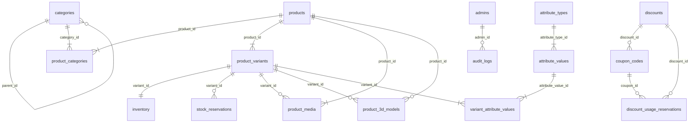

# ARTFIT — SPRINT 01 : MODÈLE LOGIQUE DE DONNÉES (MLD)
## Module : Gestion des Produits (CRUD)

- **Version du document :** 1.0.0
- **Statut :** Spécification Logique Validée
- **Date de conception :** 2026-11-16
- **Architecture obligatoire :** Architecture 3-Tiers (Couche Accès aux Données - DAL)
- **Langue du document :** Français simple — Niveau A1
- **Périmètre :** Marque unique ARTFIT — Sprint 01 : Gestion des Produits

---

## 1. But du Document

Ce document présente le **Modèle Logique de Données (MLD)** du module Gestion des Produits pour ARTFIT.

Le MLD transforme les entités et relations du MCD en tables relationnelles avec :
- Clés primaires (`PK`).
- Clés étrangères (`FK`).
- Tables d'association pour les relations plusieurs-à-plusieurs ($N:M$).
- Règles de normalisation (1NF, 2NF, 3NF).

---

## 2. Structure des 14 Tables du MLD

```text
1.  admins (id, username, email, password_hash, role, is_active, last_login_at, created_at, updated_at)
2.  categories (id, name, slug, description, parent_id*, display_order, is_active, image_url, created_at, updated_at)
3.  products (id, name, slug, description, short_description, brand_name, base_price, currency, status, is_featured, created_at, updated_at, deleted_at)
4.  product_categories (product_id*, category_id*, is_primary)
5.  attribute_types (id, name, code, display_type, created_at)
6.  attribute_values (id, attribute_type_id*, value, label, color_hex, display_order, created_at)
7.  product_variants (id, product_id*, sku, price_override, compare_at_price, cost_price, weight_kg, is_active, created_at, updated_at, deleted_at)
8.  variant_attribute_values (variant_id*, attribute_value_id*)
9.  product_media (id, product_id*, variant_id*, media_type, url, thumbnail_url, alt_text, display_order, is_primary, created_at)
10. product_3d_models (id, product_id*, variant_id*, model_url, file_format, file_size_bytes, fallback_image_url, scale_x, scale_y, scale_z, texture_maps, status, created_at, updated_at)
11. inventory (id, variant_id*, quantity_on_hand, quantity_reserved, low_stock_threshold, allow_backorder, last_restocked_at, updated_at)
12. stock_reservations (id, variant_id*, session_id, user_id, quantity, reserved_at, expires_at, status, updated_at)
13. discounts (id, name, description, discount_type, discount_value, currency, scope, target_id, starts_at, ends_at, is_active, priority, is_manual_override, is_stackable, calculation_sequence, min_order_amount_pre_discount, min_quantity, min_quantity_calc_type, apply_quantity_mode, max_quantity_capped, min_discount_amount, max_discount_amount, max_usage_total, max_usage_per_customer, times_used, created_at, updated_at)
14. coupon_codes (id, discount_id*, code, generation_type, max_uses, times_used, starts_at, expires_at, is_active, created_at, updated_at)
15. discount_usage_reservations (id, discount_id*, coupon_id*, session_id, user_id, reserved_at, expires_at, status, updated_at)
16. audit_logs (id, admin_id*, action, entity_type, entity_id, old_values, new_values, ip_address, user_agent, created_at)
```
*(Légende : Le symbole `*` indique une clé étrangère).*

---

## 3. Schéma Logique Relationnel Détaillé

---

### Table 1 : `admins` (Comptes Administrateur)
- **`id`** : Clé Primaire (`PK`), Identifiant unique.
- `username` : Nom de connexion, `NOT NULL`, `UNIQUE`.
- `email` : Adresse email, `NOT NULL`, `UNIQUE`.
- `password_hash` : Empreinte de mot de passe, `NOT NULL`.
- `role` : Rôle (`'SUPER_ADMIN'`, `'ADMIN'`, `'CATALOG_MANAGER'`), `NOT NULL`, Défaut `'SUPER_ADMIN'`.
- `is_active` : Compte actif, `BOOLEAN`, `NOT NULL`, Défaut `true`.
- `last_login_at` : Date dernière connexion, `NULLABLE`.
- `created_at` : Date de création, `NOT NULL`, Défaut UTC.
- `updated_at` : Date de modification, `NOT NULL`, Défaut UTC.

---

### Table 2 : `categories` (Catégories et Rayons)
- **`id`** : Clé Primaire (`PK`), Identifiant unique.
- `name` : Nom de la catégorie, `NOT NULL`.
- `slug` : Identifiant URL, `NOT NULL`, `UNIQUE`.
- `description` : Texte de description, `NULLABLE`.
- `parent_id` : Clé Étrangère (`FK`) $\rightarrow$ `categories(id)`, `NULLABLE` (Permet la hiérarchie infinie).
- `display_order` : Ordre d'affichage, `INTEGER`, `NOT NULL`, Défaut `0`.
- `is_active` : Catégorie active, `BOOLEAN`, `NOT NULL`, Défaut `true`.
- `image_url` : Photo d'en-tête, `VARCHAR(2048)`, `NULLABLE`.
- `created_at` : Date de création, `NOT NULL`, Défaut UTC.
- `updated_at` : Date de modification, `NOT NULL`, Défaut UTC.

---

### Table 3 : `products` (Articles et Vêtements)
- **`id`** : Clé Primaire (`PK`), Identifiant unique.
- `name` : Nom commercial, `NOT NULL`.
- `slug` : Identifiant URL, `NOT NULL`, `UNIQUE`.
- `description` : Description détaillée, `NOT NULL`.
- `short_description` : Résumé court, `VARCHAR(500)`, `NULLABLE`.
- `brand_name` : Marque unique, `VARCHAR(100)`, `NOT NULL`, Fixé à `'ARTFIT'`.
- `base_price` : Prix de référence, `DECIMAL(12,2)`, `NOT NULL`, $> 0.00$.
- `currency` : Devise unique, `VARCHAR(3)`, `NOT NULL`, Fixé à `'MAD'`.
- `status` : Statut, `VARCHAR(20)`, `NOT NULL`, Valeurs : `'DRAFT'`, `'PUBLISHED'`, `'ARCHIVED'`, Défaut `'DRAFT'`.
- `is_featured` : Mis en avant, `BOOLEAN`, `NOT NULL`, Défaut `false`.
- `created_at` : Date de création, `NOT NULL`, Défaut UTC.
- `updated_at` : Date de modification, `NOT NULL`, Défaut UTC.
- `deleted_at` : Date d'effacement doux, `NULLABLE`.

---

### Table 4 : `product_categories` (Association Produit $\leftrightarrow$ Catégorie)
- **`product_id`** : Clé Primaire part 1 (`PK`), Clé Étrangère (`FK`) $\rightarrow$ `products(id) ON DELETE CASCADE`.
- **`category_id`** : Clé Primaire part 2 (`PK`), Clé Étrangère (`FK`) $\rightarrow$ `categories(id) ON DELETE RESTRICT`.
- `is_primary` : Catégorie principale du vêtement, `BOOLEAN`, `NOT NULL`, Défaut `false`.
- *Contrainte métier :* Exactement un seul `is_primary = true` par vêtement.

---

### Table 5 : `attribute_types` (Types d'Options)
- **`id`** : Clé Primaire (`PK`), Identifiant unique.
- `name` : Nom du type (ex : Taille), `NOT NULL`.
- `code` : Code technique (ex : size), `NOT NULL`, `UNIQUE`.
- `display_type` : Type visuel (`'PILL'`, `'COLOR_SWATCH'`, `'DROPDOWN'`), `NOT NULL`, Défaut `'PILL'`.
- `created_at` : Date de création, `NOT NULL`, Défaut UTC.

---

### Table 6 : `attribute_values` (Valeurs d'Options)
- **`id`** : Clé Primaire (`PK`), Identifiant unique.
- `attribute_type_id` : Clé Étrangère (`FK`) $\rightarrow$ `attribute_types(id) ON DELETE CASCADE`.
- `value` : Valeur brute (ex : "L"), `NOT NULL`.
- `label` : Libellé affiché (ex : "Large (L)"), `NOT NULL`.
- `color_hex` : Code couleur hexadécimal (ex : `"#111111"`), `VARCHAR(7)`, `NULLABLE`.
- `display_order` : Ordre d'affichage, `INTEGER`, `NOT NULL`, Défaut `0`.
- `created_at` : Date de création, `NOT NULL`, Défaut UTC.
- *Contrainte d'unicité :* `UNIQUE(attribute_type_id, value)`.

---

### Table 7 : `product_variants` (Variantes Physiques d'un Vêtement)
- **`id`** : Clé Primaire (`PK`), Identifiant unique.
- `product_id` : Clé Étrangère (`FK`) $\rightarrow$ `products(id) ON DELETE CASCADE`.
- `sku` : Code unique d'inventaire, `VARCHAR(64)`, `NOT NULL`, `UNIQUE`.
- `price_override` : Prix spécifique en `MAD`, `DECIMAL(12,2)`, `NULLABLE`, $> 0.00$.
- `compare_at_price` : Ancien prix barré en `MAD`, `DECIMAL(12,2)`, `NULLABLE`.
- `cost_price` : Coût usine interne en `MAD`, `DECIMAL(12,2)`, `NULLABLE`.
- `weight_kg` : Poids en kg, `DECIMAL(6,3)`, Défaut `0.500`.
- `is_active` : Variante en vente, `BOOLEAN`, `NOT NULL`, Défaut `true`.
- `created_at` : Date de création, `NOT NULL`, Défaut UTC.
- `updated_at` : Date de modification, `NOT NULL`, Défaut UTC.
- `deleted_at` : Date d'effacement doux, `NULLABLE`.

---

### Table 8 : `variant_attribute_values` (Association Variante $\leftrightarrow$ Valeur d'Option)
- **`variant_id`** : Clé Primaire part 1 (`PK`), Clé Étrangère (`FK`) $\rightarrow$ `product_variants(id) ON DELETE CASCADE`.
- **`attribute_value_id`** : Clé Primaire part 2 (`PK`), Clé Étrangère (`FK`) $\rightarrow$ `attribute_values(id) ON DELETE RESTRICT`.

---

### Table 9 : `product_media` (Galerie Photos et Vidéos)
- **`id`** : Clé Primaire (`PK`), Identifiant unique.
- `product_id` : Clé Étrangère (`FK`) $\rightarrow$ `products(id) ON DELETE CASCADE`.
- `variant_id` : Clé Étrangère (`FK`) $\rightarrow$ `product_variants(id) ON DELETE SET NULL`, `NULLABLE`.
- `media_type` : Type (`'IMAGE'`, `'VIDEO'`), `NOT NULL`, Défaut `'IMAGE'`.
- `url` : Adresse web du fichier, `VARCHAR(2048)`, `NOT NULL`.
- `thumbnail_url` : Adresse web de la miniature, `VARCHAR(2048)`, `NULLABLE`.
- `alt_text` : Texte d'accessibilité, `VARCHAR(255)`, `NOT NULL`.
- `display_order` : Ordre d'affichage, `INTEGER`, `NOT NULL`, Défaut `0`.
- `is_primary` : Image principale du vêtement, `BOOLEAN`, `NOT NULL`, Défaut `false`.
- `created_at` : Date d'ajout, `NOT NULL`, Défaut UTC.

---

### Table 10 : `product_3d_models` (Fichiers 3D pour Essayage Virtuel)
- **`id`** : Clé Primaire (`PK`), Identifiant unique.
- `product_id` : Clé Étrangère (`FK`) $\rightarrow$ `products(id) ON DELETE CASCADE`.
- `variant_id` : Clé Étrangère (`FK`) $\rightarrow$ `product_variants(id) ON DELETE SET NULL`, `NULLABLE`.
- `model_url` : Fichier 3D (`.glb` / `.gltf`), `VARCHAR(2048)`, `NOT NULL`.
- `file_format` : Format (`'GLB'`, `'GLTF'`), `NOT NULL`, Défaut `'GLB'`.
- `file_size_bytes` : Taille en octets, `BIGINT`, `NOT NULL`, $\le 52\,428\,800$.
- `fallback_image_url` : Image 2D de secours, `VARCHAR(2048)`, `NOT NULL`.
- `scale_x`, `scale_y`, `scale_z` : Échelles de dimension, `DECIMAL(6,3)`, `NOT NULL`, Défaut `1.000`.
- `texture_maps` : Textures tissu, `JSONB`, `NULLABLE`.
- `status` : Disponibilité (`'ACTIVE'`, `'PROCESSING'`, `'INACTIVE'`), `NOT NULL`, Défaut `'ACTIVE'`.
- `created_at` : Date d'ajout, `NOT NULL`, Défaut UTC.
- `updated_at` : Date de mise à jour, `NOT NULL`, Défaut UTC.

---

### Table 11 : `inventory` (Stock Réel du Dépôt)
- **`id`** : Clé Primaire (`PK`), Identifiant unique.
- `variant_id` : Clé Étrangère (`FK`) $\rightarrow$ `product_variants(id) ON DELETE CASCADE`, `NOT NULL`, `UNIQUE`.
- `quantity_on_hand` : Pièces présentes au dépôt, `INTEGER`, `NOT NULL`, Défaut `0`, $\ge 0$.
- `quantity_reserved` : Pièces bloquées par paiements en cours, `INTEGER`, `NOT NULL`, Défaut `0`, $\ge 0$.
- `low_stock_threshold` : Seuil d'alerte, `INTEGER`, `NOT NULL`, Défaut `5`, $\ge 0$.
- `allow_backorder` : Vente hors stock, `BOOLEAN`, `NOT NULL`, Défaut `false`.
- `last_restocked_at` : Date dernier arrivage, `NULLABLE`.
- `updated_at` : Date de mise à jour, `NOT NULL`, Défaut UTC.

---

### Table 12 : `stock_reservations` (Réservations de Stock 60 Minutes)
- **`id`** : Clé Primaire (`PK`), Identifiant unique.
- `variant_id` : Clé Étrangère (`FK`) $\rightarrow$ `product_variants(id) ON DELETE CASCADE`.
- `session_id` : Jeton de commande ou session, `VARCHAR(128)`, `NOT NULL`.
- `user_id` : Identifiant client connecté, `NULLABLE`.
- `quantity` : Quantité bloquée, `INTEGER`, `NOT NULL`, Défaut `1`, $\ge 1$.
- `reserved_at` : Début de réservation, `NOT NULL`, Défaut UTC.
- `expires_at` : Fin de réservation ($\text{reserved\_at} + 60\text{ min}$), `NOT NULL`.
- `status` : Statut (`'ACTIVE'`, `'CONFIRMED'`, `'EXPIRED'`, `'CANCELLED'`), `NOT NULL`, Défaut `'ACTIVE'`.
- `updated_at` : Date de mise à jour, `NOT NULL`, Défaut UTC.

---

### Table 13 : `discounts` (Règles de Réduction et Promotions)
- **`id`** : Clé Primaire (`PK`), Identifiant unique.
- `name` : Nom de la promotion, `VARCHAR(150)`, `NOT NULL`.
- `description` : Explication de l'offre, `VARCHAR(500)`, `NULLABLE`.
- `discount_type` : Type (`'PERCENTAGE'`, `'FIXED_AMOUNT'`), `NOT NULL`, Défaut `'PERCENTAGE'`.
- `discount_value` : Valeur en % ou en `MAD`, `DECIMAL(12,2)`, `NOT NULL`, $> 0.00$.
- `currency` : Fixé à `'MAD'`, `VARCHAR(3)`, `NOT NULL`, Défaut `'MAD'`.
- `scope` : Cible (`'PRODUCT'`, `'VARIANT'`, `'CATEGORY'`, `'ORDER'`), `NOT NULL`, Défaut `'PRODUCT'`.
- `target_id` : Identifiant de la cible, `UUID`, `NULLABLE`.
- `starts_at` : Date de début, `NOT NULL`.
- `ends_at` : Date de fin, `NOT NULL`.
- `is_active` : Promotion active, `BOOLEAN`, `NOT NULL`, Défaut `true`.
- `priority` : Ordre de priorité, `INTEGER`, `NOT NULL`, Défaut `100`.
- `is_manual_override` : Priorité absolue forcée, `BOOLEAN`, `NOT NULL`, Défaut `false`.
- `is_stackable` : Cumulable avec d'autres réductions, `BOOLEAN`, `NOT NULL`, Défaut `false`.
- `calculation_sequence` : Ordre d'application du cumul, `INTEGER`, `NOT NULL`, Défaut `1`.
- `min_order_amount_pre_discount` : Panier minimum requis en `MAD` avant remise, `DECIMAL(12,2)`, `NULLABLE`.
- `min_quantity` : Nombre minimum d'articles, `INTEGER`, `NULLABLE`.
- `min_quantity_calc_type` : Mode de calcul (`'ELIGIBLE_ITEMS_ONLY'`, `'TOTAL_CART_ITEMS'`), `NOT NULL`, Défaut `'ELIGIBLE_ITEMS_ONLY'`.
- `apply_quantity_mode` : Mode d'application (`'ALL_UNITS'`, `'CAPPED_QUANTITY'`), `NOT NULL`, Défaut `'ALL_UNITS'`.
- `max_quantity_capped` : Plafond d'exemplaires éligibles, `INTEGER`, `NULLABLE`.
- `min_discount_amount` : Montant minimum garanti en `MAD`, `DECIMAL(12,2)`, `NULLABLE`.
- `max_discount_amount` : Plafond maximum en `MAD`, `DECIMAL(12,2)`, `NULLABLE`.
- `max_usage_total` : Quota total d'utilisations, `INTEGER`, `NULLABLE`.
- `max_usage_per_customer` : Quota par client, `INTEGER`, `NULLABLE`, Défaut `1`.
- `times_used` : Nombre de paiements avec remise, `INTEGER`, `NOT NULL`, Défaut `0`.
- `created_at` : Date de création, `NOT NULL`, Défaut UTC.
- `updated_at` : Date de mise à jour, `NOT NULL`, Défaut UTC.

---

### Table 14 : `coupon_codes` (Codes Promo)
- **`id`** : Clé Primaire (`PK`), Identifiant unique.
- `discount_id` : Clé Étrangère (`FK`) $\rightarrow$ `discounts(id) ON DELETE CASCADE`.
- `code` : Code tapé par le client, `VARCHAR(50)`, `NOT NULL`, `UNIQUE`.
- `generation_type` : Type (`'MANUAL'`, `'AUTOMATIC'`), `NOT NULL`, Défaut `'MANUAL'`.
- `max_uses` : Limite d'usage du code texte, `INTEGER`, `NULLABLE`.
- `times_used` : Nombre d'utilisations payées, `INTEGER`, `NOT NULL`, Défaut `0`.
- `starts_at` : Date de début, `NOT NULL`.
- `expires_at` : Date d'expiration, `NOT NULL`.
- `is_active` : Code utilisable, `BOOLEAN`, `NOT NULL`, Défaut `true`.
- `created_at` : Date de création, `NOT NULL`, Défaut UTC.
- `updated_at` : Date de mise à jour, `NOT NULL`, Défaut UTC.

---

### Table 15 : `discount_usage_reservations` (Réservations de Réduction 60 Minutes)
- **`id`** : Clé Primaire (`PK`), Identifiant unique.
- `discount_id` : Clé Étrangère (`FK`) $\rightarrow$ `discounts(id) ON DELETE CASCADE`.
- `coupon_id` : Clé Étrangère (`FK`) $\rightarrow$ `coupon_codes(id) ON DELETE SET NULL`, `NULLABLE`.
- `session_id` : Jeton de commande ou session, `VARCHAR(128)`, `NOT NULL`.
- `user_id` : Identifiant client connecté, `NULLABLE`.
- `reserved_at` : Début de réservation, `NOT NULL`, Défaut UTC.
- `expires_at` : Fin de réservation ($\text{reserved\_at} + 60\text{ min}$), `NOT NULL`.
- `status` : Statut (`'ACTIVE'`, `'CONSUMED'`, `'EXPIRED'`, `'CANCELLED'`), `NOT NULL`, Défaut `'ACTIVE'`.
- `updated_at` : Date de mise à jour, `NOT NULL`, Défaut UTC.

---

### Table 16 : `audit_logs` (Journal d'Audit et Sécurité)
- **`id`** : Clé Primaire (`PK`), Identifiant unique.
- `admin_id` : Clé Étrangère (`FK`) $\rightarrow$ `admins(id) ON DELETE RESTRICT`.
- `action` : Nom de l'action (ex : `'PRODUCT_CREATE'`), `VARCHAR(40)`, `NOT NULL`.
- `entity_type` : Entité modifiée (ex : `'PRODUCT'`), `VARCHAR(50)`, `NOT NULL`.
- `entity_id` : Identifiant de l'élément modifié, `VARCHAR(64)`, `NOT NULL`.
- `old_values` : Données avant modification, `JSONB`, `NULLABLE`.
- `new_values` : Données après modification, `JSONB`, `NULLABLE`.
- `ip_address` : Adresse IP de l'administrateur, `VARCHAR(45)`, `NULLABLE`.
- `user_agent` : Navigateur utilisé, `VARCHAR(500)`, `NULLABLE`.
- `created_at` : Date et heure exacte, `NOT NULL`, Défaut UTC.

---

## 4. Vérification de la Normalisation

1. **Première Forme Normale (1NF) :**
   - Toutes les colonnes contiennent des valeurs atomiques (une seule donnée par cellule).
   - Les listes (plusieurs catégories, plusieurs attributs, plusieurs photos) sont séparées dans des tables relationnelles dédiées.

2. **Deuxième Forme Normale (2NF) :**
   - Le modèle respecte la 1NF.
   - Toutes les colonnes non-clés dépendent entièrement de la totalité de la clé primaire (particulièrement vérifié sur les tables d'association à clés composites `product_categories` et `variant_attribute_values`).

3. **Troisième Forme Normale (3NF) :**
   - Le modèle respecte la 2NF.
   - Aucune colonne non-clé ne dépend d'une autre colonne non-clé (pas de dépendance transitive).
   - Les calculs au vol (comme le stock disponible ou les totaux de réduction) ne sont pas enregistrés en dur dans la table.

---

## 5. Diagramme Logique Relationnel (Mermaid)



