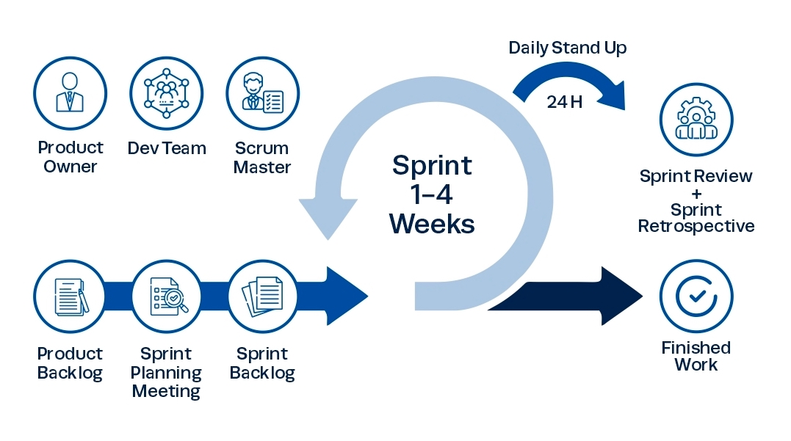
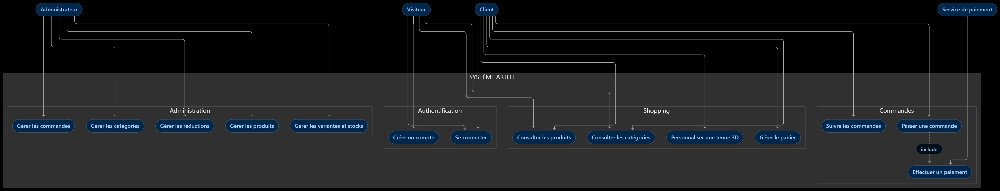

<!-- _class: title-slide -->

  
  

# ARTFIT

## Plateforme de shopping et de personnalisation de vêtements en 3D

**Projet de fin de formation — SoliCode**

Présenté par : **Oumaima Mahfoud**

Encadré par : **ES-SARRAJ FOUAD**

Année : 2026–2027

---

## Plan de la présentation

1. Introduction et contexte du projet
2. Méthodologies et planification
3. Branche fonctionnelle
4. Compréhension du besoin : empathie, problématique et idéation
5. Conception : diagrammes de cas d'utilisation et de classes
6. Stack technologique et structure technique
7. Conclusion

---

## Introduction

Le commerce électronique évolue rapidement.

Aujourd'hui, les clients peuvent acheter des vêtements sur Internet, mais ils ne peuvent pas toujours visualiser facilement le résultat avant l'achat.

ARTFIT propose une nouvelle expérience de shopping qui combine la mode, la personnalisation et la technologie 3D.

---

## Contexte du projet

Le shopping en ligne présente plusieurs difficultés :

- Difficulté de choisir une tenue adaptée.
- Absence d'essayage physique.
- Manque de visualisation des vêtements portés.
- Difficulté de personnaliser son style.

**ARTFIT** est une plateforme qui permet de découvrir, composer et personnaliser des tenues avec une expérience de visualisation 3D.

---

# les methodologies 

---

<!-- _class: image-only -->

## Scrum

---

<!-- _class: image-only -->

## Processus 2TUP

---

<!-- _class: image-only -->

## Design Thinking

---

## Planification

Le projet est organisé en plusieurs sprints:

**Sprint 01 — Gestion des produits**
- CRUD Product.
- Affichage des produits dans la plateforme.
- Diagramme de cas d'utilisation.

---

**Sprint 02 — Gestion des catégories**
- CRUD Category.
- Organisation des fichiers.
- Séparation des responsabilités.

---

**Sprint 03 — Architecture**
- Utilisation du pattern DAO.
- Architecture en 3 couches.
- Séparation de la logique métier et des données.
  
---

## Branche fonctionnelle

---

**Acteurs principaux :**

- **Visiteur** : consulter les produits et créer un compte.
- **Client** : gérer son compte, personnaliser ses tenues et commander.
- **Administrateur** : gérer les produits, les catégories, les stocks, les utilisateurs et les commandes.
- **Service de paiement** : traiter les paiements.
---

**Principaux modules :**

- Authentification et autorisations.
- Gestion du catalogue.
- Gestion des produits et variantes.
- Personnalisation 3D.
- Panier et commandes.
- Gestion des réductions et réservations de stock.

---

## Carte d'empathie

**Utilisateur cible : le client qui achète des vêtements en ligne.**

- **Dit :** Je veux trouver une tenue qui correspond à mon style.
- **Pense :** Est-ce que cette tenue va me convenir ?
- **Fait :** Il consulte plusieurs produits et compare les vêtements.
- **Ressent :** Il hésite avant de passer une commande.

**Besoin :** choisir et visualiser une tenue avant de l'acheter.

---

## Définition du problème

**Problématique :**

Comment améliorer l'expérience du shopping en ligne et aider les clients à choisir leurs vêtements avant de passer une commande ?

**Solution :**

Créer ARTFIT, une plateforme qui permet de découvrir, personnaliser et visualiser des tenues en 3D.

---

## Idéation

Les idées proposées pour répondre au problème :

- Créer un catalogue de vêtements.
- Ajouter des filtres de recherche.
- Proposer plusieurs tailles et couleurs.
- Permettre la personnalisation des tenues.
- Intégrer une visualisation 3D interactive.
- Proposer un panier et un système de commande.
- Créer une interface moderne et responsive.

**Idée principale : transformer le shopping en une expérience interactive en 3D.**

---

<!-- _class: image-only -->

## Diagramme de cas d'utilisation

---

## Stack technologique

- **Backend** · PHP 8.2 · Laravel 12
- **Autorisations** · Spatie Laravel Permission
- **Mobile** · NativePHP
- **Frontend** · Blade · Tailwind CSS · Alpine.js · Preline · Vite
- **Base de données** · MySQL
- **3D** · Three.js
- **Diagrammes** · Mermaid · PlantUML
- **Versioning** · Git · GitHub

---

<!-- _class: image-only -->

## Diagramme de classes

---

## Conclusion

- Une plateforme e-commerce spécialisée dans la mode.
- Une gestion complète des produits et des variantes.
- Une personnalisation et une visualisation des tenues en 3D.
- Une architecture organisée en trois couches.
- Une expérience de shopping moderne et interactive.

---

# Merci pour votre attention !

